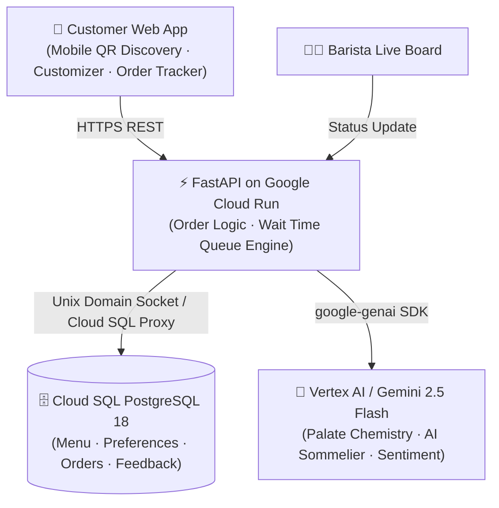
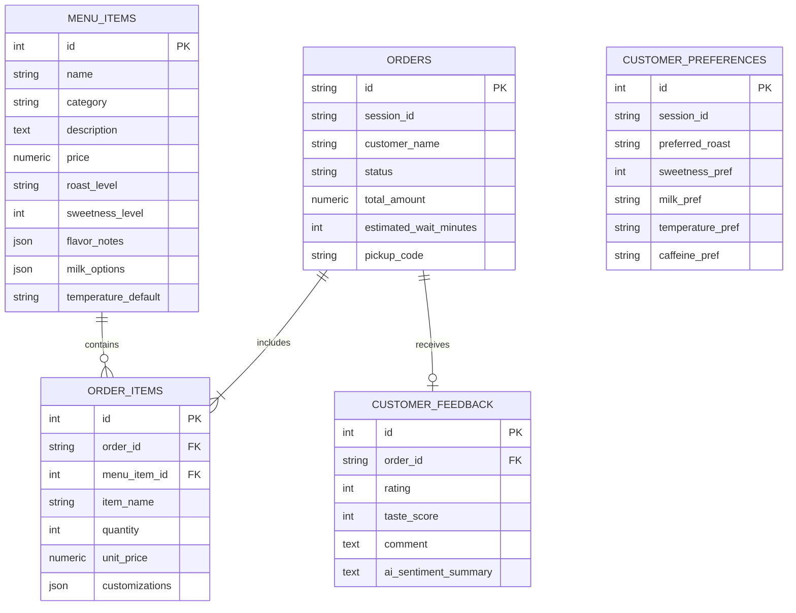

# SipSense AI ☕

[](https://python.org)
[](https://fastapi.tiangolo.com)
[](https://cloud.google.com/run)
[](https://cloud.google.com/sql)
[](https://cloud.google.com/vertex-ai)

> **Next-Generation Artisanal Coffee Discovery, Sensory AI Sommelier, and Real-Time Barista Queue System**

---

## 🌟 Live Deployment

- 🌐 **Production Web Application**: [https://sipsense-app-239920603011.asia-south1.run.app](https://sipsense-app-239920603011.asia-south1.run.app)
- 📖 **Interactive Swagger / OpenAPI Docs**: [https://sipsense-app-239920603011.asia-south1.run.app/docs](https://sipsense-app-239920603011.asia-south1.run.app/docs)
- 🩺 **Health Check**: [https://sipsense-app-239920603011.asia-south1.run.app/health](https://sipsense-app-239920603011.asia-south1.run.app/health)

---

## 📐 System Architecture



### Architectural Highlights
1. **Customer Web App**: Responsive mobile-first interface designed with an artisanal dark espresso aesthetic, smooth glassmorphism, micro-animations, and live queue polling.
2. **FastAPI Engine**: Asynchronous Python backend executing order lifecycle state transitions, subtotal calculation with customizations, and dynamic wait-time estimation based on active tickets.
3. **Vertex AI / Gemini 2.5 Flash**: Multi-dimensional sensory analysis matching customer cravings (roast, sweetness, milk profile, acidity, and caffeine tolerance) to active roastery offerings.
4. **Cloud SQL PostgreSQL**: Managed relational persistence running PostgreSQL 18 with connection pooling, indexes, and automated foreign key cascades.

---

## ✨ Core Features

### 1. "Find My Sip" AI Sommelier Matchmaker
- **Freeform Craving Search**: Customers can type natural language desires (e.g., *"Need high energy, low acid, velvety oat milk with nutty cocoa finish"*).
- **Interactive Palate Questionnaire**: 4-step wizard collecting roast level, sweetness (0–5 scale), milk preference, serving temperature, and dietary needs.
- **Tasting Cards**: Returns exact match score percentage, sensory breakdown of why the customer will love it, and custom barista tweaks.

### 2. Conversational Barista AI (Floating Widget)
- Interactive floating chat bubble available anywhere in the app.
- Powered by `gemini-2.5-flash` with full context of the active roastery menu to discuss bean origins, roast chemistry, and pairings.

### 3. Drink Customizer
- Interactive adjustments for:
  - **Milk Alternatives**: Oat Milk, Almond Milk, Farm Fresh Whole Milk, Organic Pistachio Milk, or None.
  - **Sweetness Scale**: Unsweetened (0%), Light (25%), Regular (50%), Extra Sweet (100%).
  - **Temperature**: Hot (Velvet Microfoam), Iced (Over Clear Cubes), or Extra Iced.
  - **Extra Espresso Boost**: +1 or +2 Ristretto Shots (+$0.75 / shot) with real-time price updates.
  - **Barista Preparation Notes**: Special instructions passed directly to the order ticket.

### 4. Real-Time Order Tracking & Queue Engine
- 3-step live progress stepper: **Placed → Brewing → Ready for Pickup**.
- Live queue position calculation (`#1 in line`, `#2 in line`).
- Estimated wait time countdown dynamically computed from active queue volume.
- Unique 3-digit pickup PIN and digital ticket representation to present at counter.

### 5. Barista Live Workflow Board
- Operational interface for cafe baristas to advance drink lifecycle states.
- Triggers instant live status synchronization to the customer's tracking view.

### 6. Customer Taste Feedback & Sentiment Intelligence
- Post-pickup rating (1–5 stars) and taste balance evaluation.
- Gemini automatically summarizes customer comments into concise barista intelligence.

---

## 🗄️ Database Schema

The database runs on **Google Cloud SQL PostgreSQL** (`sipsense-pg`) under database `sipsense`:



---

## 📡 API Reference

| Method | Endpoint | Description |
| :--- | :--- | :--- |
| `GET` | `/health` | Service health status, active project, and database identity |
| `GET` | `/api/menu` | List catalog items with category, roast, and search filters |
| `GET` | `/api/menu/{id}` | Detailed tasting notes and options for a specific drink |
| `POST` | `/api/ai/recommend` | Gemini palate matching engine returning top recommendations |
| `POST` | `/api/ai/chat` | Conversational barista sommelier assistant |
| `POST` | `/api/orders` | Create a new order ticket with customizations |
| `GET` | `/api/orders/{id}` | Real-time order tracking and queue position |
| `POST` | `/api/orders/{id}/status` | Advance order state (`PLACED` → `BREWING` → `READY` → `COMPLETED`) |
| `GET` | `/api/orders/queue/live` | Retrieve all active orders on the barista queue board |
| `POST` | `/api/orders/{id}/feedback` | Submit star rating, taste feedback, and AI sentiment analysis |
| `GET` | `/api/analytics/insights` | Aggregated cafe intelligence and top-ordered items |

---

## 💻 Local Development Setup

### 1. Prerequisites
- Python 3.11+
- Google Cloud SDK (`gcloud`) authenticated (`gcloud auth login`)
- Cloud SQL Auth Proxy (`cloud-sql-proxy.exe`)

### 2. Installation
```powershell
# Clone the repository
git clone https://github.com/krishnasai-narayana/sipsenseAI.git
cd sipsenseAI

# Activate virtual environment
.\.venv\Scripts\Activate.ps1

# Install dependencies
pip install -r requirements.txt
```

### 3. Environment Configuration (`.env`)
Create a `.env` file in the root directory:
```env
PROJECT_ID=sipsense-ai-demo
REGION=asia-south1
VERTEX_LOCATION=us-central1
INSTANCE_CONNECTION_NAME=sipsense-ai-demo:asia-south1:sipsense-pg

# Local Database via Cloud SQL Auth Proxy
DB_HOST=127.0.0.1
DB_PORT=5432
DB_NAME=sipsense
DB_USER=sipsense_app
DB_PASSWORD=YourDatabasePassword

# Service Account credentials for local Cloud SQL & Vertex AI
GOOGLE_APPLICATION_CREDENTIALS=sa-key.json
GEMINI_MODEL=gemini-2.5-flash
```

### 4. Running the Development Stack
```powershell
# One-click runner starts proxy and uvicorn:
.\run_local.ps1
```
Or start manually:
```powershell
# 1. Start Cloud SQL Auth Proxy:
.\cloud-sql-proxy.exe --credentials-file sa-key.json sipsense-ai-demo:asia-south1:sipsense-pg --port 5432

# 2. Run FastAPI:
uvicorn app.main:app --host 127.0.0.1 --port 8000 --reload
```

---

## 🚀 Cloud Run Deployment

Deploy the entire containerized application to Google Cloud Run in a single command:

```powershell
.\deploy_cloud_run.ps1
```

Or via `gcloud` CLI:
```powershell
gcloud run deploy sipsense-app `
  --source . `
  --project sipsense-ai-demo `
  --region asia-south1 `
  --platform managed `
  --allow-unauthenticated `
  --service-account=sipsense-app-sa@sipsense-ai-demo.iam.gserviceaccount.com `
  --add-cloudsql-instances=sipsense-ai-demo:asia-south1:sipsense-pg `
  --set-env-vars="PROJECT_ID=sipsense-ai-demo,REGION=asia-south1,VERTEX_LOCATION=us-central1,INSTANCE_CONNECTION_NAME=sipsense-ai-demo:asia-south1:sipsense-pg,DB_NAME=sipsense,DB_USER=sipsense_app,DB_PASSWORD=Asdf@6891,GEMINI_MODEL=gemini-2.5-flash"
```

---

## 🔒 Security Best Practices

- **Zero Hardcoded Secrets**: Secrets and credentials (`.env`, `sa-key.json`) are excluded in `.gitignore` and `.dockerignore`.
- **Identity-Aware IAM**: Cloud Run utilizes a dedicated least-privilege service account (`sipsense-app-sa`) granted strictly `roles/cloudsql.client` and `roles/aiplatform.user`.
- **Mutual TLS**: Database connections are encrypted end-to-end via Cloud SQL Auth Proxy locally and Unix Domain Sockets on Cloud Run.

---

## 📄 License
Distributed under the Apache 2.0 License. Built for specialty coffee enthusiasts and AI-driven sensory experiences.
